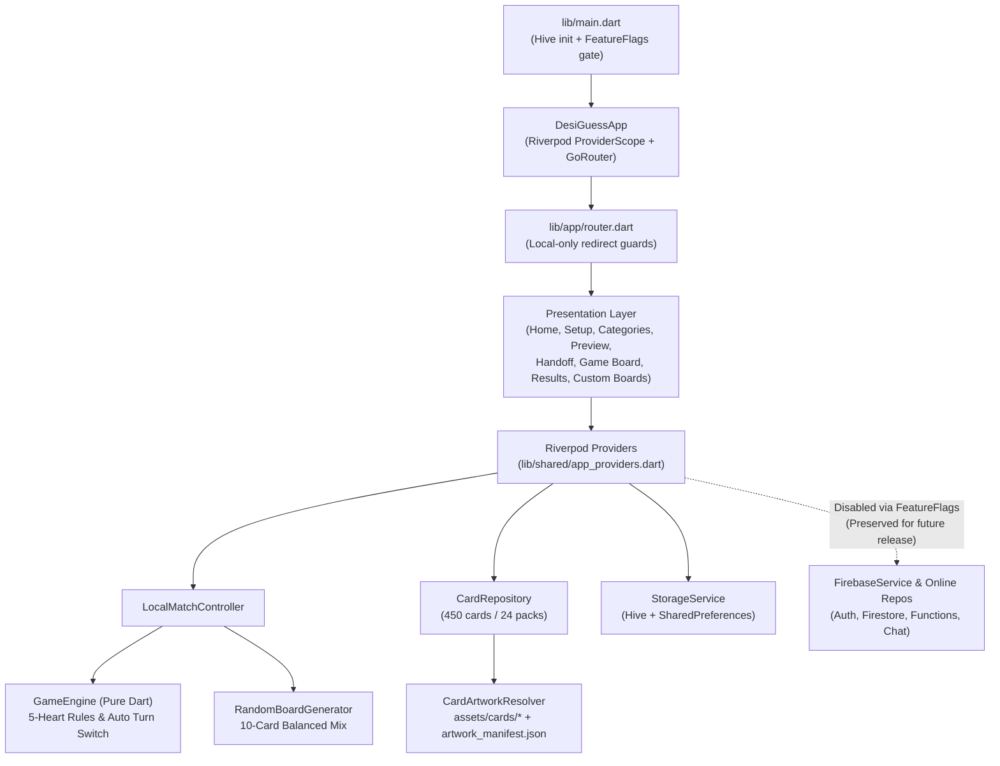

# Technical Architecture — Desi Guess

Desi Guess follows a feature-first **Clean Architecture** layout in Flutter, keeping pure Dart game rules strictly decoupled from UI widgets, local storage, and the preserved Firebase backend.

---

## High-Level Architecture



---

## Directory Structure

```text
desi-guess/
├── README.md                     # Project landing page & build guide
├── docs/                         # Project documentation (overview, rules, architecture, changelog, contributing, walkthrough)
├── reports/                      # Image audit reports (XLSX, PDF) & attribution registry
├── assets/
│   ├── cards/                    # 450 verified 320x320 card JPEGs + artwork_manifest.json
│   ├── icons/, images/, illustrations/, animations/, sounds/
├── lib/
│   ├── main.dart                 # App bootstrap, portrait lock, Hive init, guarded Firebase init
│   ├── app/                      # MaterialApp.router, GoRouter guards, AppTheme
│   ├── core/                     # FeatureFlags, constants, l10n (EN/Hinglish), services, shared widgets
│   ├── models/game_models.dart   # Immutable models (GameCard, BoardPack, GameMatchState, etc.)
│   ├── shared/app_providers.dart # Riverpod providers wiring repositories and controllers
│   └── features/
│       ├── authentication/       # Splash, Onboarding, Local Player Setup (+ preserved Login/Register)
│       ├── cards/                # 450-card data packs, RandomBoardGenerator, Category/Pack screens
│       ├── custom_boards/        # Offline custom board & card creator (Hive-backed)
│       ├── game/                 # Pure Dart GameEngine, LocalMatchController, Board/Handoff/Results
│       ├── home/                 # Simplified Local Home, Pass & Play Setup, Settings, Help & Rules
│       ├── profile/              # Local player profile, stats, achievements (+ preserved Friends)
│       ├── leaderboard/          # Preserved for future online release (guarded off)
│       ├── multiplayer/          # Preserved online room/lobby code (guarded off)
│       └── chat/                 # Preserved Firestore real-time chat code (guarded off)
├── test/                         # Unit, widget, asset-integrity & end-to-end test suites
├── android/, ios/, web/          # Platform configurations (FlutLab compatible)
└── functions/                    # Preserved Firebase Cloud Functions & security rules
```

---

## Core Subsystems

### 1. Application Entry Point & Feature Gating
- `lib/main.dart` initializes Hive (`StorageService`) first and checks `FeatureFlags.enableOnlineMultiplayer && kEnableFirebase` before touching Firebase.
- Because both default to `false`, Firebase is never initialized in Local Edition and the app boots completely offline without `google-services.json`.

### 2. Navigation & Local-Only Guards (`lib/app/router.dart`)
- Built with `go_router`.
- When `FeatureFlags.enableOnlineMultiplayer` is `false`, a router-level `redirect` automatically routes `/online/*` → `/play`, `/game/chat/*` → `/game/history`, `/friends` & `/leaderboard` → `/home`, and `/login` & `/register` → `/guest-login`, while forcing `mode: 'local'` and `roomId: null` on gameplay routes.

### 3. Game Engine & State Management
- **Pure Dart `GameEngine`** (`lib/features/game/domain/game_engine.dart`) enforces all rules independently of Flutter/Firebase:
  - 5 starting hearts per player (`AppConstants.startingHearts = 5`).
  - Own secret card exclusion from elimination and final guessing.
  - `submitFinalGuess`: correct guess immediately completes the match; incorrect guess deducts 1 heart, completes the match on `0` hearts (skipping turn switch), or calls `_advanceTurn` to automatically pass control to the next active player with `requiresPrivacyHandoff = true`.
  - No manual `endTurn()` action exists.
- **`LocalMatchController`** (`lib/features/game/presentation/local_match_controller.dart`) is a Riverpod `StateNotifier<GameMatchState?>` that delegates every transition to `GameEngine`, triggers `AudioService` SFX, updates local player stats/achievements, and persists match state to Hive for instant resume after app restart.

### 4. Models & Random Board Generation
- `lib/models/game_models.dart` defines `GameCard`, `BoardPack`, `PlayerMatchState`, `QuestionEntry`, `MatchResult`, `UserProfile`, and `AppSettings` with full JSON serialization.
- `RandomBoardGenerator` (`lib/features/cards/domain/random_board_generator.dart`) constructs a balanced 10-card `BoardPack` across all active subcategories of a chosen category and assigns two distinct secret cards (`player1SecretCardId != player2SecretCardId`).

### 5. Card Assets & Artwork Manifest
- All 450 card images are stored as `320×320` JPEGs under `assets/cards/{who,what,where}/<subcategory>/<card_id>.jpg` and resolved deterministically via `CardArtworkResolver`.
- `assets/cards/artwork_manifest.json` tracks all 450 entries (`verifiedCount: 395`, `manualVerificationCount: 55`, `missingCardIds: []`) with source URLs, attributions, and licences.

### 6. Preserved Firebase Integration (Disabled)
- Firebase repositories (`auth_repository.dart`, `multiplayer_repository.dart`, `chat_repository.dart`, `profile_repository.dart`, `custom_board_repository.dart`), security rules (`firestore.rules`, `storage.rules`), indexes (`firestore.indexes.json`), and Cloud Functions (`functions/`) remain intact and compile cleanly.
- They stay inert unless `FeatureFlags.defaultEnableOnlineMultiplayer` and `ENABLE_FIREBASE` are explicitly enabled in a future release.

### 7. Platform & Testing Structure
- **Android**: `android/` configured with Gradle `8.10.2`, AGP `8.7.3`, Kotlin `2.1.0` (FlutLab compatible).
- **iOS**: `ios/` preserved intact for Xcode builds.
- **Tests (`test/`)**:
  - `game_engine_test.dart` — Five-heart rules, automatic turn switch, elimination, serialization.
  - `card_library_test.dart` — 450 unique card IDs, 24 packs, search, custom board rules.
  - `random_board_and_secrets_test.dart` — Balanced 10-card generation, distinct secrets, offline startup.
  - `room_and_profile_test.dart` — Room code utilities, profile stats, achievements.
  - `widget_test.dart` — Home, localization, local-only guards, full Pass-and-Play flow, narrow `360px` layout overflow checks.
  - `e2e_multiplayer_and_audit_test.dart` — Manifest/asset disk verification, custom board ownership, end-to-end local flows, and preserved online regression coverage.
